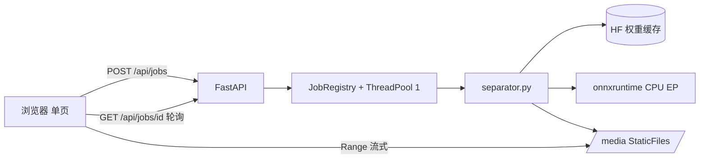

## 用户需求

本期**只做一个声轨分离工具**，不包含任何转谱、扒谱、audio→MIDI 功能。音高线提取与「导入 OpenUtau」明确推迟到后续版本，本期只在目录与数据结构上留好接缝，不实现、不安装相关依赖。

## 产品概述

一个在本机运行的本地 Web 工具（FastAPI + 免构建前端）：把一首完整混音拖进浏览器，服务端用 HT-Demucs FT 的 ONNX 权重分离出鼓、贝斯、其他、人声四条轨道，页面上以多轨工作台的形式同步试听、单独静音与独奏、逐轨或打包下载。全流程纯 CPU 可跑，不依赖 PyTorch。

## 核心功能

- **音频上传**：拖拽或点选上传，支持 wav/flac/mp3；m4a 仅在检测到 ffmpeg 时开放。显示文件名、时长、体积，超出时长或体积上限时给出明确提示。
- **三档模型选择**：四轨质量档（默认）、仅人声快档（省约四倍算力）、四轨快速档；每档旁标注权重大小与预计耗时，切换后主按钮文案同步变化。
- **后台任务与进度**：服务端单 worker 串行排队，前端轮询显示阶段（下载权重→加载模型→逐轨分离）与已耗时；支持取消，取消在当前轨处理完后生效。
- **多轨工作台**：四条轨道等高纵向堆叠，左侧轨头含名称、静音 M、独奏 S、音量、单轨下载；右侧为共享时间轴的 canvas 波形，一条播放头贯穿四轨。
- **结果导出**：一键打包 zip 下载全部轨道（44.1 kHz 立体声 WAV）。
- **运行环境自检**：展示 ONNX Runtime 可用执行器、权重是否已缓存、ffmpeg 是否可用；ffmpeg 缺失时说明降级为仅支持 wav/flac/mp3。

## 视觉预期

深夜录音棚质感的深色界面：近黑底色让波形成为唯一主角，琥珀色为唯一高饱和强调色（播放头、进行中的进度、主按钮），青绿仅表示完成态；数字统一等宽字形；单页三态（上传 / 处理 / 工作台）之间平滑位移淡入淡出，控制条紧凑高密度，不做营销页式的花哨排版。


## 技术栈选择

| 层 | 选择 | 理由 |
|---|---|---|
| 运行时 | Python **3.11**（`uv python pin 3.11`，本机已有 cpython-3.11.15） | `demucs-onnx==0.3.4` 的 classifiers 仅到 3.13，3.14 属未测试区间；其依赖 `soundfile`/`soxr` 为 C 扩展，cp314 wheel 覆盖需实测，Windows 上源码编译代价高；本机切换成本为零；后续音高提取常用的 `parselmouth`/`pyworld` 在 3.11 上 wheel 覆盖最全 |
| 分轨推理 | `demucs-onnx==0.3.4`（MIT），核心依赖仅 `onnxruntime` + `numpy` + `soundfile` + `soxr` + `tqdm` + `huggingface-hub` | 纯 numpy/ORT 推理，无需 PyTorch，也不需要 ffmpeg；权重自动从 HF `StemSplitio` 拉取 |
| 服务端 | FastAPI + uvicorn | 单进程即可，原生 StaticFiles 支持 Range |
| 任务调度 | 进程内 `ThreadPoolExecutor(max_workers=1)` + 内存 Job 表 | 不引 Celery/Redis，符合轻量定位；单 worker 把峰值内存锁在约 1.5 GB |
| 前端 | 免构建静态文件（`index.html` + `style.css` + `app.js`）+ Web Audio API | 本地工具不引入 npm/Vite；**不使用 CDN、不引入 Tailwind**，纯手写 CSS + CSS 变量，保证完全离线可用 |

**权重档位**：一律使用 `_fp16weights` 变体（体积减半，运行时按 fp32 计算，最大绝对误差约 6e-5，速度内存与 fp32 一致）。`htdemucs_ft` 四专家 bag = 660 MB（默认）；`htdemucs_ft_vocals` 单专家 = 166 MB；`htdemucs` 单文件 = 166 MB。

## 实现方案

### 总体策略

1. **按 stem 逐个调用推理**，而不是一次跑完四轨。`htdemucs_ft` 本身就是「每个源一个微调专家」的 bag，单 stem 调用在该轨上等价于整 bag，但带来三个收益：进度可按 0/25/50/75/100 自然上报；峰值内存只驻留一个 session（约 600 MB）；每个 stem 之间是天然的取消检查点。
2. **音频入口只做一次规整**：上传后立刻解码并重采样为 44.1 kHz 立体声 WAV，写死到 `data/jobs/{id}/input.wav`，后续四个 stem 复用同一文件，避免重复解码与重采样。
3. **媒体走 StaticFiles 挂载**而非逐个 FileResponse：Starlette 静态服务原生支持 Range 请求，`<audio>` 拖动定位才能工作。
4. **服务端只做「排队 + 状态」**：POST 立即返回 job_id，前端 1 秒轮询；任何异常写入 job.error 并保留可读摘要，不阻塞事件循环。

### 关键决策与权衡

- **ffmpeg 是可选依赖，不是必需依赖**：解码主链路用 `soundfile`（libsndfile），重采样用 `soxr`。只有 m4a/aac 这类 libsndfile 不认的容器才调用 ffmpeg。路径用 `shutil.which("ffmpeg")` 探测 + `PITCHMORPH_FFMPEG` 环境变量覆盖；版本号只在自检面板展示、不做校验。探测不到时把 m4a 从可选格式中移除并在 UI 说明，而不是启动失败或上传报错。
- **不做 GPU 自动探测**：保留 `PITCHMORPH_PROVIDERS` 环境变量透传给 ORT，默认 `CPUExecutionProvider`。本机未装 CUDA 工具包，自动探测一旦走错会以难以理解的 ORT 报错终止，而不只是变慢。
- **不伪造进度百分比**：`demucs-onnx` 的 Python API 没有逐帧回调。进度按「阶段 + 已完成 stem 数」表达，配合已耗时显示。
- **不做启动期预下载权重**：会让首次启动挂几分钟且不可取消；改为任务级下载并复用 HF 缓存，UI 明示「首次需下载约 660 MB」。支持 `HF_ENDPOINT=https://hf-mirror.com` 与手动放置权重目录的兜底。
- **单 worker 串行 + 队列上限 3**：并行会让内存跳到 4–6 GB 并拖慢单曲，与轻量定位相悖；超出队列直接拒绝并提示。

### 性能与可靠性

- 3 分钟歌曲在普通 Windows CPU 上四轨预计 2–5 分钟（参考 M4 Pro CPU EP 约 88 秒，RTF≈0.49）。任务化 + 进度 + 取消是必需项。
- ORT 设 `intra_op_num_threads = min(8, os.cpu_count())`，避免占满全部核心导致页面卡顿。
- 上传上限：100 MB 或 12 分钟，超限直接拒绝并提示分段。输出统一 44.1 kHz 立体声 WAV。
- 磁盘：`data/jobs/{job_id}/` 下 `input.wav` 与 `stems/*.wav`；启动时与每小时清理超过 24 小时的目录；删除任务同步删目录。
- 安全：job_id 用 uuid4；所有文件访问只经 `/media` 挂载的前缀，不接受用户传入路径；上传文件名仅用于展示，落盘一律用 uuid。

## 架构设计



数据流：上传 → 解码规整为 `input.wav` → 入队 → 逐 stem 加载 session 推理写 `stems/{name}.wav` → 更新 job.stems → 前端切到工作台读取 `/media/jobs/{id}/stems/*.wav`。

## 目录结构

```
PitchMorph/
├── pyproject.toml                    # [NEW] uv 工程声明；requires-python = ">=3.11,<3.12"；依赖 fastapi、uvicorn[standard]、python-multipart、demucs-onnx==0.3.4（禁止加 [export]）
├── .python-version                   # [NEW] 内容为 3.11，锁定 uv 使用已安装的 3.11.15
├── .gitignore                        # [NEW] 仅忽略 .venv/、data/、__pycache__/；**不得忽略 .agent/**（记忆需随仓库走）
├── README.md                         # [NEW] 启动方式、首次下载说明、HF 镜像配置、三档模型对比、ffmpeg 可选依赖说明、后续 M2/M3 路线
├── .agent/memory/                    # [KEEP] 既有记忆目录，本期不改动
└── app/
    ├── __init__.py                   # [NEW] 空包标记
    ├── config.py                     # [NEW] 路径常量、上传上限、模型档位定义（别名/轨数/体积/预计耗时）、providers 与线程数、ffmpeg 探测（shutil.which + PITCHMORPH_FFMPEG 覆盖，结果带缓存）
    ├── schemas.py                    # [NEW] Pydantic 模型：JobCreateResponse、JobStatusResponse（stage/progress/stem/elapsed/stems/error）、ModelInfo、HealthResponse
    ├── separator.py                  # [NEW] 分轨核心。decode_to_wav（soundfile+soxr，m4a 走 ffmpeg 兜底）、权重缓存探测、按 stem 逐个推理、on_progress 回调、should_cancel 检查点；不向上层暴露 ORT 细节
    ├── jobs.py                       # [NEW] 内存 Job 表 + ThreadPoolExecutor(max_workers=1) + 队列上限 + threading.Event 取消 + 24h 定时清理；Lock 保证线程安全
    ├── main.py                       # [NEW] FastAPI 实例、挂载 /media（follow_symlink=False，根固定为 data/jobs）、路由：POST /api/jobs、GET /api/jobs/{id}、DELETE /api/jobs/{id}、GET /api/jobs/{id}/download（zip）、GET /api/models、GET /api/health、GET / 返回 index.html
    └── static/
        ├── index.html                # [NEW] 单页三态结构（上传 / 处理 / 工作台），语义化标签与 aria 标注，自检面板为 dialog
        ├── style.css                 # [NEW] 手写深色工作站主题：CSS 变量色板与间距、玻璃面板、轨道条、传输控制条、进度阶指示、窄屏折叠；不引 CDN
        └── app.js                    # [NEW] 状态机（idle→uploading→processing→ready→error）、轮询、Web Audio 同步播放（单 AudioContext + 4 个 MediaElementSource + 主时钟对齐）、canvas 波形与双色播放扫过、M/S/音量、下载
```

## 关键代码结构

```python
# app/separator.py
def decode_to_wav(src: Path, dst: Path) -> float:
    """解码并规整为 44.1k 立体声 WAV，返回时长（秒）。
    wav/flac/mp3 走 soundfile + soxr；m4a 等容器仅在 ffmpeg 可用时经子进程转换。
    ffmpeg 不可用且格式无法解码时抛 UnsupportedFormat。
    """

def separate_stems(
    src_wav: Path, out_dir: Path, *,
    model: str = "htdemucs_ft",
    stems: tuple[str, ...] = ("drums", "bass", "other", "vocals"),
    on_progress: Callable[[float, str], None] | None = None,
    should_cancel: Callable[[], bool] | None = None,
) -> dict[str, Path]:
    """按 stem 逐个推理并写入 out_dir/{stem}.wav（44.1k 立体声）。
    每个 stem 开始前调用 should_cancel()，为真则抛 Canceled 并清理半成品。
    """
```

```python
# app/schemas.py
class JobStage(str, Enum):
    QUEUED = "queued"; DOWNLOADING = "downloading"; LOADING = "loading"
    SEPARATING = "separating"; DONE = "done"; CANCELED = "canceled"; ERROR = "error"

class JobStatusResponse(BaseModel):
    id: str
    stage: JobStage
    progress: float                 # 0..1，按已完成 stem 数推进
    stem: str | None                # 当前正在处理的 stem
    elapsed_sec: float
    stems: dict[str, str]           # {"drums": "/media/jobs/<id>/stems/drums.wav", ...}
    error: str | None
```

## 实施注意事项

- **绝不安装 `demucs-onnx[export]`**：它会拉 `torch>=2.4,<2.5` + `demucs==4.0.1`，与「无 PyTorch」目标直接冲突。输出 WAV 也不需要 `[mp3]` 的 `lameenc`。
- 动手前先执行 `demucs-onnx list-models` 核对模型别名，别名以实际输出为准，不要凭文档猜字符串。
- `StaticFiles` 必须 `follow_symlink=False`，挂载根固定在 `data/jobs`，不要暴露 `data` 根目录。
- 日志用标准 `logging`：INFO 记录阶段流转（job_id / 模型 / 时长 / stem / 耗时），ERROR 记录 traceback；不打印采样数据，也不打印用户目录绝对路径。
- 取消基于 `threading.Event`，只在 stem 边界生效（ORT 推理过程中无法中断），UI 文案须说明「将在当前轨结束后停止」，避免用户误以为卡死。
- 权重目录探测与下载分离：启动只探测不下载；下载失败时把 HF 镜像提示写进 job.error，便于用户自行切换 `HF_ENDPOINT`。
- 为 M2 留接缝但不过度设计：`stems/` 与未来 `features/` 平级，轨道文件名固定为 drums/bass/other/vocals，确保后续直接按路径取 vocals。


## 设计风格

「深夜录音棚 + 现代音频工作站」。近黑底色让波形成为视觉主体，琥珀色是唯一高饱和强调色，青绿只用于完成/就绪状态。面板用极细 1px 边框加低透明度分层阴影，不用大面积投影，避免廉价的卡片堆叠感。所有数字（时间轴、时长、耗时）使用等宽字形，保证跳动时不抖动。全部为手写 CSS + CSS 变量，不引 CDN、不引 Tailwind，保证离线可用。

## 页面规划（单页三态，共 1 屏）

**Block 1 · 顶栏**：左侧波形图标与 PitchMorph 字标，中间环境徽标（CPU EP / 权重已缓存），右侧「环境自检」图标按钮，点击以 dialog 弹出 ORT 执行器、模型缓存路径、ffmpeg 可用性。

**Block 2 · 上传态主区**：视口中部的虚线拖拽区，中央大号「拖入音频」与格式说明；拖入时边框转琥珀并轻微内发光。下方紧凑参数条为三档模型分段切换，每档右侧以弱化小字标注「660MB · 约 3 分钟」这类成本，选择后主按钮文案同步变化。

**Block 3 · 处理态**：拖拽区原位替换为任务卡——文件信息行、四段阶段指示（下载 → 加载 → 分离 → 完成）以细线连接，当前段琥珀高亮带流动光效；下方显示「正在分离 bass · 2/4 · 已用 01:12」，取消按钮为次要样式，点击后转为「将在当前轨结束后停止」。

**Block 4 · 多轨工作台**：四条等高轨道纵向堆叠，左侧固定轨头含名称、M/S 圆钮、音量滑杆、下载图标，右侧 canvas 波形共享同一时间刻度，一条琥珀播放头贯穿四轨。行悬停整行上浮一级；静音态波形降至 30% 透明度；独奏时其余轨道同步变暗。

**Block 5 · 传输控制条**：吸附在工作台底部，含 44px 琥珀实心播放圆钮、等宽当前时间/总时长、可拖动进度条（悬停放大热区）、循环区间开关、右侧「下载全部」主按钮。

## 交互与动效

- 播放头与进度条共用 `requestAnimationFrame` 更新，不用 `setInterval`，避免抖动。
- 波形双色绘制：已播放段不透明琥珀，未播放段低透明度灰白，形成播放扫过效果。
- 状态切换用 180–240ms 位移加透明度过渡：上传卡向下淡出，工作台自下方 12px 上移淡入。
- 所有可交互元素有 `:focus-visible` 琥珀描边；波形未就绪时显示骨架条纹而非空白。
- 窄屏（<760px）轨头收缩为图标列，音量滑杆进入弹出层，传输条保持吸底。


### Skill
- **frontend-design**
  - Purpose: 产出上传态、处理态、四轨工作台三套界面的实际代码（`index.html` / `style.css` / `app.js`），包含深色工作站视觉、canvas 双色波形、播放头扫过、M/S 变暗、状态切换过渡，避免模板化的通用 AI 观感。
  - Expected outcome: 可直接被 FastAPI 静态托管、完全离线（不依赖任何 CDN 资源）、在 1440 宽与 760 以下窄屏均布局完整且交互可用的单页界面。
