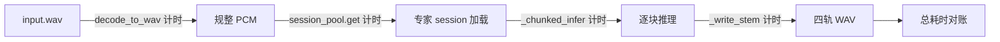

## 用户需求

用户反馈：一首 3 分钟的歌走默认 quality 档，耗时 5–10 分钟，想搞清楚慢在哪、能不能用 GPU 加速。

## 产品概述

本次交付的是一份**带数字的诊断结论**，而不是功能改动。结论需要用本机真实音频实测得出，回答三个问题：时间究竟花在哪一段；每一段各占多少；GPU 加速在本机是否可行、能带来多大提升。

## 核心功能

- **耗时拆解瀑布**：把一次 quality 档分轨拆成解码规整、模型加载、逐块推理、写盘四段，给出各段秒数与占比。
- **单块基准**：测出单个 7.8 秒音频块在 CPU 上的稳定耗时与 RTF（每 1 秒音频消耗多少秒算力），作为所有推算的基准线。
- **档位成本测算**：验证「4 个专家 = 4 倍算力」是否成立，量化换成快速档（单文件四轨）能省多少。
- **线程利用率判断**：确认 ONNX Runtime 是否吃满了 CPU 核数，判断是否存在无须额外成本的提速空间。
- **GPU 可行性结论**：在不安装任何依赖的前提下，给出本机走 CUDA / DirectML / 维持 CPU 三条路的预期收益、前置条件与风险，并明确「如果要做得改哪些文件」。

## 边界

- 不安装 onnxruntime-gpu、CUDA、cuDNN 等任何依赖。
- 不修改仓库内的任何源码、配置与文档。
- 不联网下载新权重，也不删除 `data/jobs` 下已有的用户音频与产物。


## 技术栈

沿用现有环境，不新增任何依赖：

- Python 3.11（`.venv`，直接调用 `.venv\Scripts\python.exe`，**不用 `uv run`**，以免触发依赖解析与联网）
- onnxruntime **1.31.1（CPU wheel）**，`ort.get_available_providers()` 目前只会有 CPU 系
- demucs-onnx 0.3.4，`htdemucs_ft` 四个专家的 fp16 ONNX 已在 `data/models` 缓存齐全（每个 157.94 MB），可完全离线跑
- numpy / soundfile（现成依赖）

## 实施策略

核心思路：**先用微基准把「一块 7.8 秒音频要跑多久」这个最小单元测准，再用端到端实测对账，最后用对账结果推算档位与 GPU 的收益**。这样即使端到端只跑一次，结论仍然可复核。

三处已知的、需要在测量中验证的怀疑点（均在代码中确认）：

1. **算力放大 4 倍**：`app/separator.py:394-419` 对 `tier.stems` 逐个循环，每个专家都把整首歌完整跑一遍，只取输出矩阵里属于自己那一行。所以 quality 档的实际计算量是单网络的 4 倍。
2. **每轨重载模型**：`app/separator.py:415` 每个 stem 结束调用 `session_pool().clear()`，下一个 stem 要重新读 157.94 MB 图并重跑 ORT 图优化。这是 4 次固定开销，需要量化它占总时长的比例。
3. **线程数未显式设置**：上游 `demucs_onnx/inference.py:194-199` 的 `_make_session()` 只设了 `graph_optimization_level=ORT_ENABLE_ALL`，`intra_op_num_threads` 走 ORT 默认值（物理核数）。笔记本上是否真的吃满、会不会被电源策略限制，必须实测。

### 测量方法

**Phase 1 · 环境事实（只读命令，约 30 秒）**

- `nvidia-smi --query-gpu=name,driver_version,memory.total,compute_cap --format=csv`
- `Get-CimInstance Win32_Processor | Select-Object Name,NumberOfCores,NumberOfLogicalProcessors`
- `.venv\Scripts\python.exe -c "import onnxruntime as ort, platform; print(ort.__version__, ort.get_available_providers())"`
- 现有素材清点：`data/jobs` 下三个 input.wav（28.66 MB ≈ 162 s、18.47 MB ≈ 105 s、724 KB ≈ 4 s），确认 benchmark 用哪一段，全程不需要联网。

**Phase 2 · 单块微基准（约 1 分钟）**

固定输入 `[1, 2, 343980]` float32（`N_SAMPLES` 来自 `demucs_onnx.inference`，即 7.8 s @ 44.1 kHz）：

- 计时 `session_pool().get(path, ["CPUExecutionProvider"])` → 得到**模型加载耗时**（clear 的代价就是它）
- 预热 1 次后稳态重复 5 次，取中位数 → `t_chunk`
- 换算 `RTF = t_chunk / 7.8`，以及一首 3 分钟歌在单网络下的理论耗时
- 记录 `session.get_providers()`，确认真的在 CPU 上跑

线程扫描（同一块输入，自建 session 绕过 pool）：

- `SessionOptions(intra_op_num_threads = k, inter_op_num_threads = 1)`，k 取 默认 / 物理核 / 物理核÷2 / 4
- 判据：默认值与物理核数相差 <5% → 已吃满，没有免费收益；相差显著 → 说明 ORT 没用满，属于可低成本获得的收益

**Phase 3 · 端到端对账（约 4–6 分钟）**

用 105 秒的真实 `input.wav` 跑一次 quality 全流程，**以运行时插桩（monkeypatch）计时，不改任何源码**：

- 包装 `separator.session_pool` 的 `get/clear` → 每轨加载耗时
- 包装 `separator.decode_to_wav` → 解码耗时
- 包装 `separator._write_stem` → 写盘耗时
- 推理耗时 = 总耗时 − 上述三项
- 记录每个 chunk 的耗时序列，看是否随时间上升（笔记本热降频的特征）还是平稳

插桩只在临时脚本进程内生效，退出即失效；输出目录指向 `%TEMP%`，**不写 `data/jobs`**。

如果实跑时间超出预期，退化为只跑 drums + vocals 两个专家再线性外推，并在结论里明确标注哪些数字是实测、哪些是外推。

**Phase 4 · GPU 可行性评估（不动系统）**

只做静态判断 + 版本核对，不安装：

- 前提核查：Blackwell（sm_120）需要 CUDA 12.8+ 的 ORT 构建与 cuDNN 9；驱动版本决定可支持的 CUDA 上限
- 依赖冲突：`demucs-onnx` 硬依赖 `onnxruntime`（`uv.lock` 已确认），而 ORT 官方明确 `onnxruntime` 与 `onnxruntime-gpu` **不能同时安装**。要落地必须用 optional extra 或独立环境，这是成本项，不是一行命令
- 收益上限分析：图输入是**编译期固定 shape、batch 恒为 1**（`app/separator.py:307-311`），GPU 收益取决于单块算力与 kernel launch / H2D-D2H 拷贝的比值；HTDemucs 内部含 STFT 与 Transformer 段，笔记本 GPU 上不一定线性提速。结论按「预期区间 + 必须先验证的 3 个信号」给出
- 备选路线对比：CUDA（性能上限高、安装成本大、与现有 venv 冲突）、DirectML（零 CUDA 依赖、fp32 卷积性能弱、算子回落风险）、维持 CPU + 优化（换档位、线程数、专家并行）

## 架构设计：测量点分布



四个插桩点全部来自现有函数，不新增生产代码；启动路径、接口、前端一律不动。

## 实施注意事项

- **不要用 `uv run`**：它可能触发一次依赖解析，与「不装任何东西」冲突；直接用 `.venv\Scripts\python.exe`。
- **设 `HF_HUB_OFFLINE=1`**：即使权重齐全，也确保 huggingface_hub 不会尝试联网探活；`_resolve_paths` 本身已用 `local_files_only=True`，双保险。
- **不要设置 `PITCHMORPH_PROVIDERS`**：保持默认 CPU，否则 benchmark 失去意义。
- **测量前确认服务未在跑**：`jobs.py` 是单 worker，若 uvicorn 正在分离任务，CPU 会争抢，数字不可用。
- **笔记本测量条件**：接电源、高性能电源计划、关闭其他重负载程序。否则测得的是降频态，会把结论误导向「必须上 GPU」。这一点要在报告里写明前提。
- **不碰数值代码**：`_chunked_infer` 的分块与 overlap-add 逻辑不做任何修改（AGENTS.md 要求与上游逐采样一致）。
- **总耗时上限**：Phases 1–3 约 6–8 分钟 CPU 时间，不跑大文件、不重复跑同一档位。
- **结论需区分实测与推算**：`fast` 档（`htdemucs` 单文件）权重未缓存，**不下载**，其耗时用单专家 RTF 推算得到，报告里必须标注为推算值。

## 目录结构

仓库内不修改任何文件；全部产物落在系统临时目录，跑完可整体删除。

```
仓库（0 文件变更）
c:/Users/Acer/daily/coding/Python/PitchMorph/
├── app/                 # 只读
├── data/models/         # 只读（4 个 fp16 ONNX，离线跑 benchmark 用）
└── data/jobs/           # 只读（复用 input.wav，产物写到别处）

$env:TEMP/pitchmorph-bench/
├── bench.py              # [NEW] 临时基准脚本，四个 phase 由 argv 选择：env / chunk / threads / e2e
│                         #   只 import app.separator 与 demucs_onnx，配合 monkeypatch 计时，
│                         #   输出结构化 JSON 到 out/，不产生仓库写入
└── out/
    ├── chunk.json        # [NEW] 单块耗时、RTF、模型加载耗时、线程扫描结果
    └── e2e/              # [NEW] 端到端试跑的四轨 WAV（临时，可删除）
```

